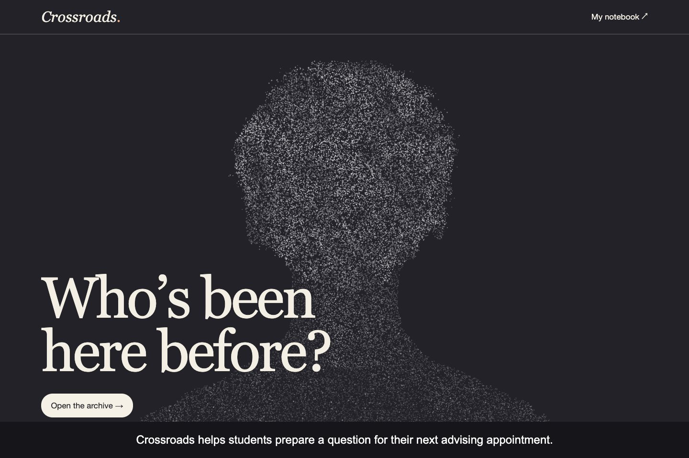

# Crossroads
A student considering a semester away can read how three people approached work and study, then leave with one question to ask the registrar and a date to revisit the decision.

[Open the public web app](https://hackathon-b4455.web.app). No sign-in is required.

## Verified in the submitted build
On the public site, the semester-off walkthrough returned a live Firebase cloud response with App Check enforced. At 390 px and 1280 px, the notebook retained its decision after reload and exported a calendar event. Our clean Chrome test reported local inference unavailable; the device-only path displayed a recovery message and kept the editable question. A successful on-device response still needs a compatible Chrome installation.

## Run the web app
Use Node 22.12+ and desktop Chrome. From this directory run `npm ci`, then `npm run dev` and open the printed local URL. The archive and notebook work immediately. For a production build run `npm test` then `npm run build`. Serve the dist directory over HTTPS.

## Enable actual AI responses
1. Register a Web app in your Firebase project. In Firebase AI Logic, complete the Gemini Developer API setup. Use the no-billing Spark tier for the demo. Alternatively use Firebase CLI's `init ailogic` for this project.
2. In Firebase App Check register the Web app with reCAPTCHA Enterprise. Add the app's real hosting domain to the site key, and verify enforcement for Firebase AI Logic. For local testing use a separately registered development domain or Google's documented App Check debug flow in a local-only build. Never publish debug tokens or service account credentials.
3. Copy .env.example to .env.local. Enter the registered Web app's project ID, app ID, Firebase Web API key and public reCAPTCHA Enterprise site key. Restart Vite or rebuild after changes.
4. For Firebase Hosting run `npx firebase-tools login`, `npm run build`, then `npx firebase-tools deploy --only hosting --project YOUR_PROJECT_ID`. Opening the finished site requires no sign-in.
5. For supported Chrome hardware and model download/flag requirements use the [Firebase Web hybrid guide](https://firebase.google.com/docs/ai-logic/hybrid/web/get-started). Local inference requires a supported desktop Chrome configuration; mobile browser layout is supported separately.

## Judge walkthrough
- Open the archive. Enter “I want to take a semester off to work.” Confirm the suggested topic; compare Gates, Jobs and Curie. Open a source. Pick “Keep one class.”
- On a compatible Chrome installation with the local model ready, leave cloud permission off and request a tailored adviser question. The UI reports the SDK source on success.
- On a device without local inference, enable cloud fallback and retry with internet access. Open the material preview. Cloud-permitted requests use the public topic, selected record and archive question. They exclude your personal note, even if the SDK ultimately runs on the device. Confirm the actual source shown. If both routes fail, the original editable question remains available.
- Edit the question and add a next step and review date. Save, reload My notebook and export the calendar event. Import it into your own calendar to receive its reminder.
- Enter “I am not sure” to see the manual topic choices. Clear site storage to remove saved notes.

## Architecture and attribution
ai.js initializes Firebase App Check before Firebase AI Logic. A user gesture initializes Chrome's device model. ONLY_ON_DEVICE keeps generation local. PREFER_ON_DEVICE lets the SDK use Gemini in the cloud when needed. The SDK inferenceSource is displayed with the result. The notebook uses browser storage; the app does not upload it. catalog.js holds 24 editorial perspectives across eight topics. The three cases on semester leave link to institutional sources. Some other entries identify publications by title only.

The Korean prototype supplied the decision archive, interaction concept and cover art. The English edition introduces a new interface, English records and questions, device-only and consent-based hybrid generation, SDK route attribution, App Check integration and an English judging workflow. Built with Codex and official Firebase hybrid documentation and Firebase agent skill guidance. No audience size or outcome claims.

Original project code is licensed under Apache 2.0. Library licenses remain with their respective packages. Third-party photographs have separate attribution and licenses in public/credits.html.
